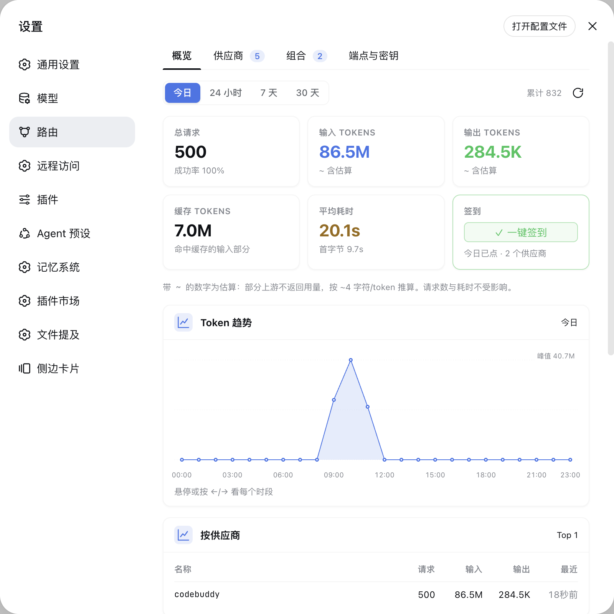

<h1 align="center">dsh-router</h1>

<p align="center">DeepSeek Harness 的 OpenAI 兼容路由插件</p>

<p align="center">
  <a href="https://www.npmjs.com/package/dsh-router-core"></a>
  <a href="LICENSE"></a>
  <a href="https://www.npmjs.com/package/@deepseek-ai/dsh?activeTab=versions"></a>
  <a href="#agent-team-支持"></a>
</p>

<p align="center">
  <a href="#快速安装">快速安装</a> ·
  <a href="#面板设置--路由">面板</a> ·
  <a href="#agent-team-支持">Agent Team</a> ·
  <a href="#api-端点openai-兼容v1">API 端点</a> ·
  <a href="docs/suppliers.md">供应商开发</a> ·
  <a href="docs/ext.md">扩展开发</a>
</p>

直接把 DSH 变成一个**多协议、多供应商的模型网关** —— 不是另开一个网关服务,
而是作为插件嵌进 DSH web,在宿主 Web 服务上原生暴露四个端点,把请求路由到内部供应商。
管理界面在**设置 → 路由**(官方设置页座位,不是自己开的页面)。装好即用:
不另起进程、不占第二个端口、不用在网关和 DSH 之间搬配置。

**四种协议双向互转**(详见 [四种协议入口](#四种协议入口)):

| 端点 | 客户端 | 协议 |
| --- | --- | --- |
| `POST /v1/chat/completions` | OpenAI SDK / Cline / DSH 自身 | OpenAI Chat Completions |
| `POST /v1/messages` | **Claude Code** | Anthropic Messages |
| `POST /v1/responses` | **Codex** | OpenAI Responses |
| `POST /v1beta/models/<m>:generateContent` | **Gemini CLI** | Google Gemini |

四个入口共享同一套鉴权、账号池、组合回退与用量统计。把 Claude Code 的
`ANTHROPIC_BASE_URL` 指过来,它用的就是你的账号池;Codex、Gemini CLI 同理。
供应商侧也可以说这四种里的任意一种 —— 声明一下方言,核心负责翻译。

**原生支持 Agent Team / 多会话** —— team 的每个成员是独立会话,
dsh-router 按**会话身份**亲和选号:同会话固定落同一个连接(前缀缓存只写一份),
不同会话尽量铺开到不同连接;多会话共用同号时按会话隔离统计,**不会互相拖累**。
详见 [Agent Team 支持](#agent-team-支持)。



## 快速安装

需要 **DSH `0.2.0` 及以上**、Node.js `>= 20`,以及 `web` profile。0.1.x 宿主不再支持(设置注册、
tool 消息形态都已按 0.2.0 单面实现)。

```bash
dsh plugin --profile web add dsh-router-core
```

然后**重启 `dsh web`**。打开设置面板,左侧导航「模型」下面会出现 **路由**。

第二处入口是侧栏的**插件**面板:内置的供应商与扩展在那里各占一行「包含的组件」,
**供应商与扩展的开关也在那一面**(见 [面板](#面板设置--路由)与
[供应商开关](#供应商开关))。

> 更多供应商:DSH 插件形态的供应商各自发 npm 包,同样
> `dsh plugin --profile web add <包名>` 即可;供应商接入与开发见
> [`docs/suppliers.md`](docs/suppliers.md)。
>
> 本地开发版:不用 npm,直接 `dependencies` 加
> `"dsh-router-core": "link:/path/to/dsh-router"` 指向本地仓库。

## 它解决什么问题

| 能力           | 说明                                                                                                                                                                                                                                                         |
| -------------- | ------------------------------------------------------------------------------------------------------------------------------------------------------------------------------------------------------------------------------------------------------------ |
| 零额外进程     | 就是 DSH 插件,随 `dsh web` 启停,天然同源(`/router/api/*` 无 CORS、面板嵌在设置里)。                                                                                                                                                                          |
| 四协议互转     | Chat / Anthropic / Responses / Gemini 进站出站都认,Claude Code、Codex、Gemini CLI 直接接上来就能用账号池。供应商侧也只需声明方言,翻译在核心统一做。                                                                                                            |
| 扩展即插即拔   | 扩展插件(如 [`dsh-router-ext-rtk`](https://github.com/CARVIN94/dsh-router-ext-rtk))经 `router.ext` 注册,在 bash 执行前改写命令(如加 `rtk` 前缀压缩输出)。开关在官方插件页(设置 → 插件 → dsh-router-core),带自检;面板「扩展」页只列已启用的、只读。 |
| 供应商即插即拔 | 内置供应商是插件页「包含的组件」里的三行,可单独开关;更多供应商 = 装一个 DSH 插件(`dsh-router-*`)或放一个 js 文件到 `~/.dsh/profiles/web/suppliers/`(同名 js 覆盖内置)。                                                                                                                                       |
| 模型不内置     | 供应商只实现差异化能力,模型拉取与缓存由核心统一管,不写死、不过时。                                                                                                                                                                                           |
| 策略只写一次   | 组合回退、账号池(选号/冷却/禁用)、响应写入、凭证存储、积分持久化、模型管理都由核心提供。供应商 js 只对**单个账号**调一次上游并报告成败,不自己遍历账号、不维护冷却表、不落盘积分——否则每个插件都会长出一份互相不一致的实现,而核心也就无从判断「该不该换号」。 |
| 凭证单库       | `auths/credentials.sqlite`,供应商凭证不透明 blob,核心统一生命周期,干净可备份。                                                                                                                                                                               |
| 组合即模型     | 建好的组合自动带出为 DSH 模型目录里的 `router` provider 选项,设置 → 模型直接选组合名即可。                                                                                                                                                                   |
| 用量可观测     | 面板概览看板:周期切换、汇总卡、趋势折线、Top 榜、最近请求。                                                                                                                                                                                                  |
| Team 友好      | 按**会话身份**亲和选号:同会话固定同一连接(前缀缓存只写一份),不同会话尽量铺开到不同连接;多会话共用同号时缓存质量**按会话隔离**统计,不会互相拖累。                                                                                                            |

> 供应商开发与接入规范见 [`docs/suppliers.md`](docs/suppliers.md)
> （契约 / 加载顺序 / 模型统一策略 / 内置供应商参考实现）。
> 选号/亲和/team 的完整设计与实测见
> [`docs/pool-sticky-block.md`](docs/pool-sticky-block.md)。

## Agent Team 支持

DSH 的**智能体团队**把任务拆给多个成员,**每个成员是独立会话**,一轮
team 测试就是多个会话交错发请求。dsh-router 原生适配这个场景:

- **真会话身份** —— 从宿主 `GenerateOptions.sessionId` 拿到权威会话 id
  (adapter 转成内部头),不再靠猜。有 id 就按 id 亲和,精确、零撞车;
  外部 OpenAI 客户端拿不到 id 时,回落前缀指纹兜底。
- **会话亲和选号** —— 同一会话的连续请求**永远落回同一个连接**,前缀在该
  连接缓存里只写一份,缓存命中率稳定在 ~98%;新会话按游标分发,天然均衡。
- **fresh 会话优先铺开** —— 多个成员交替到达时,优先分配到**还没被别的会话
  占用**的连接,各成员尽量独占一个连接;连接数不够时才回绕复用。
- **按会话隔离的缓存统计** —— 多会话共用同号时,**各会话的缓存质量分开统计**,
  不会因为别的会话"踩"了同一个号就把这个号误判成"缓存坏了"从而集体降权
  (消除了 team 场景下的「降权串」)。
- **底部命中指示** —— 输入框旁的「路由」徽章按**当前会话**显示最近一次命中
  的连接/积分;点击展开卡片,点外部或 `Esc` 收起(与原生弹层一致)。

> 天花板:**连接数 < 并发成员数**时,多出来的成员必然共用连接 → 前缀缓存互相
> 驱逐,无法用选号手法消除(上游缓存空间是账号侧物理限制)。要彻底隔离只能
> **加连接**或**限制 team 并发成员数 ≤ 连接数**。详见
> [`docs/pool-sticky-block.md`](docs/pool-sticky-block.md) §11。
>
> 版本适配:插件按 **DSH 0.2.0 单面**实现(0.1.5/0.1.7 的兼容分叉已删除)。跑在
> 低于 0.2.0 的宿主上仍会加载,但会在宿主日志里打一条警告 —— 那些症状与「插件坏了」
> 无法区分,所以宁可出声。

## 面板(设置 → 路由)

面板挂在 **设置 → 路由**(官方 `settings.section` 座位,排在「模型」下面):

第二处入口是**设置 → 插件 → dsh-router-core 的详情页**,那里分两层:

- 宿主的原生**「包含的组件」**列 core 自己 patch 里声明的**行**:core 本体、三个
  内置供应商、分层提示词这个内置扩展。每行一个宿主管的开关,关一行 = loader 不
  import 它 = 它压根没注册。
- 原生列表**下面**是本插件自绘的**「路由组件」**一节,列**外部供应商插件**与
  **扩展插件**,两组都带开关。

两层的分工:**已经在原生行里的(内置的那些)不进自绘节** —— 同一份东西列两遍,
用户就不知道该在哪开关。反过来说外部供应商与扩展进不了原生行:官方那个列表只认
**本 bundle 自己 patch 里声明的行**(`declaredRows` 只读该 bundle 自己的 patch),
而它们各自是独立 bundle,自己的行在自己的详情页上。

- **概览** — 用量看板(默认页):
  - 周期切换 **今日 / 24 小时 / 7 天 / 30 天**;
  - 汇总卡:总请求(含成功率)、输入 Tokens、输出 Tokens、缓存 Tokens、平均耗时(含首字节);
  - 签到卡:**一键签到**所有支持签到的供应商(按 `checkinNow` 能力筛),并显示
    「今天点过没」;
  - Token 趋势折线图:鼠标悬停 / 触摸点选 / 键盘 `←` `→`(`Home` `End` 到两端,`Esc` 取消)
    看每个时段;读数和峰值用 K/M 缩写,精确值在悬停提示里;
  - Top 榜:按供应商 / 按模型(请求数带失败计数);
  - 最近请求:时间 / 模型 / 供应商 / in↑ out↓ / 耗时,显示最近 10 条;
  - **清空** — 清掉全部用量统计(不影响供应商、账号、组合配置);
  - 数据落盘 `data/usage.json`(按天聚合 + 每天 24 个小时桶 + 最近 500 条明细 +
    累计计数)。今日/7 天/30 天读天桶、24 小时读小时桶,都不受明细环容量限制;
    明细环只服务「最近请求」列表。
    小时桶从新数据开始累积,升级前那几天的天内分布查不到(明细环只剩 500 条
    回溯不回去),那段历史的小时柱状图留空、24 小时口径按整桶计入 —— 不编数据。
    token 口径:上游返回 `usage` 就用真值(分散在多帧时按字段取最大值合并);
    上游不发时按 ~4 字符/token 估算,面板上标 `~`。**失败请求不估算**——
    它没到上游,编造输入 token 只会把总量灌水;
    缓存口径:OpenAI 系 `prompt_tokens` **含**缓存,Claude 系不含(单报
    `cache_read_input_tokens`),归一时统一折成「prompt 含缓存」,
    所以「缓存 Tokens」是「输入 Tokens」的**子集**,不是并列的第三种;
    签到口径:卡片上的「今日已点」= 今天在这个浏览器点过这个按钮(记在
    localStorage),**不代表上游一定签上了**——真凭据是上游的 `checked_in`,
    当前契约没有「查签到状态」的能力,要真状态得先给供应商契约加
    `checkinStatus?()`(升级路径写进 `CheckinCard.tsx` 头注释)。
- **供应商** — 供应商卡片(内置 / 插件分组),点击进入详情:
  - **链接池** — 账号列表(冷却/禁用/健康数/积分),支持删除;
  - **加链接** — 按供应商能力弹出不同流程:URL 登录(生成链接 → 浏览器登录 → 回调)、
    API key 弹窗(填名字 + key)、轮询登录(登录后自动取凭证);
  - **签到** — 供应商实现了签到的才显示(如 codebuddy:每日 100 积分,连续第 7 天1000)。核心遍历所有链接逐个签,汇总「N/M 成功 · X 今日已签」;上游「今日已
    签到」按成功处理(幂等),账号额度或凭证失效会单独标出;
  - **刷新** — 刷所有链接的积分,并跑一次最简会话探测该供应商是否还有活着的链接
    (走真实对话路径 + 账号池回退,能分清是账号额度没了还是供应商真挂了);
  - **可用模型** — 模型列表,逐个启用/禁用 + 自定义模型(通用能力,持久化到
    `data/supplier-config.json`,`/v1/models` 与 chat 只接受启用的模型);单个模型可
    「测试」,走真实对话路径并按账号池依次回退,所以能分清是这个账号额度没了还是
    该模型真的不支持;
- **组合** — fallback 链(免费优先),可自定义。**组合即模型**:建好的组合会**自动带出**
  为 DSH 模型目录里的 `router` provider 选项(设置 → 模型直接选组合名即可用),请求
  按组合策略命中其中一个供应商模型;
- **端点与密钥** — 端点核心(无隧道/Tailscale):
  - API 端点 URL(面板按当前页面 origin 显示,可复制;端口跟着宿主走,`dsh web` 默认 3080);
  - 鉴权设置 `requireApiKey` 开关;
  - API Keys 管理:创建 / 启用切换 / 显示 / 复制 / 删除(持久化到 `data/keys.json`)。

## API 端点(OpenAI 兼容,`/v1`)

> 端口 = **宿主 Web 服务实际监听的端口**:`dsh web` 默认 3080,桌面端等通道由宿主
> 分配(不一定还是 3080)。下面按 3080 写;换通道时把端口换成面板「端点与密钥」
> 页里显示的那个即可。

```bash
# 模型列表
curl http://localhost:3080/v1/models

# 对话(流式/非流式)
curl -X POST http://localhost:3080/v1/chat/completions \
  -H "Content-Type: application/json" \
  -d '{"model":"glm-5.2","messages":[{"role":"user","content":"你好"}],"stream":false}'
```

任何支持 OpenAI 兼容 API 的工具(Claude Code、Cline、DSH 设置-模型 等)都可以把
`baseURL` 指向面板「端点与密钥」页里显示的那个端点(`dsh web` 下即 `http://localhost:3080/v1`)。

### 四种协议入口

不止 OpenAI Chat。四种协议**双向互转**,进站认客户端说的方言,出站按供应商
声明的方言请求,中间收敛成一种规范形态(OpenAI Chat Completions 请求体 + 一组
扁平事件),所以是 4 个协议模块而不是 4×3 = 12 条翻译路径。

| 入口 | 客户端 | 说明 |
| --- | --- | --- |
| `POST /v1/chat/completions` | OpenAI Chat 系(Cline、DSH 设置-模型、任意 OpenAI SDK) | 规范形态本身,字节级透传 |
| `POST /v1/messages` | Claude Code | Anthropic Messages。`count_tokens` 返回 501(没有本地 tokenizer 就不编数字) |
| `POST /v1/responses` | Codex | OpenAI Responses |
| `POST /v1beta/models/<model>:generateContent`<br>`...:streamGenerateContent` | Gemini CLI | 模型名在**路径**里;`?alt=sse` 等 query 会先切掉再解析 |

四个入口共享同一套鉴权(`Authorization: Bearer`)、同一个账号池与组合回退、
同一份用量统计。换协议只是换入口,不会多一份账号池实现。

**把客户端接过来,只需改一个环境变量**(以 Claude Code 为例):

```bash
export ANTHROPIC_BASE_URL=http://127.0.0.1:3080
export ANTHROPIC_AUTH_TOKEN=<面板「端点与密钥」里建的 key>
claude   # 从此走 dsh-router 的账号池、组合回退与用量统计
```

Codex 用 `base_url` 指向同一个地址 + `/v1`,Gemini CLI 用
`GOOGLE_GEMINI_BASE_URL`。三者都自动获得面板里配的供应商、冷却与失败转移 ——
不需要为每个客户端各配一份 key。

**反方向也成立**:供应商可以在契约里声明自己说哪种协议(`wire`),核心负责把
规范请求翻成它的方言、再把响应翻回来。所以接一个只会说 Anthropic 的上游,
插件里只需要几行 `fetch`,不必自己写协议转换。

**跨协议会丢的东西**(明确不做翻译,各协议模块注释里逐条点名):Anthropic 的
`cache_control`、Responses 的 `previous_response_id` / `store`、Gemini 的
`safetySettings`。它们在目标协议里没有对应概念,硬造一个只是猜。

**实测过**(2026-10-21,真宿主 + 真实上游):四种协议的非流式与流式往返、
Anthropic 的工具调用(非流式 `tool_use` 与流式 `content_block_start` +
`input_json_delta` 增量)、用量从上游一路带到客户端。

接线与语义层有七处坑是编解码器全绿也发现不了的:prefix 尾斜杠导致 404/405、
`chatCompletions` 造了 sink 却仍写 `res`、入站 tools 方向搞反、Gemini 的流式
标志在 URL 不在 body、Anthropic 收尾帧的用量不能单独发、Gemini 的
`finishReason` 不能排在 `functionCall` 之前、纯工具调用流在收尾前一个字节都
没有(收尾兜底判据得看「尾巴有没有内容」而不是「之前有没有写过」)。逐条记在
[`docs/protocols.md`](docs/protocols.md)。

设计取舍、各协议的坑(工具调用的三种编码、收尾的四种词汇、用量分散在不同帧)、
测试策略见 [`docs/protocols.md`](docs/protocols.md)。

**鉴权**:默认 `requireApiKey=false`,`/v1/*` 不要求鉴权(本地使用如此)。
在「端点与密钥」页开启「要求 API Key」后,请求必须带
`Authorization: Bearer <库内启用的 Key>`。

## 面板 API(`/router/api/*`,同源)

| 端点                            | 方法      | 说明                                                                   |
| ------------------------------- | --------- | ---------------------------------------------------------------------- |
| `/health`                       | GET       | 供应商列表(含来源/能力/开关 `enabled`)+ 宿主版本 `hostVersion` / 徽章支持位 `lastHitDock` |
| `/last-hit`                     | GET       | 最近一次命中 `?session=<id>`(按会话取,缺省全局);供「路由」徽章 |
| `/status`                       | GET       | 全部账号(含供应商 id)                                                  |
| `/models`                       | GET       | 合并模型列表(已过滤禁用)                                               |
| `/combos`                       | GET       | 组合 fallback 链                                                       |
| `/keys`                         | GET/POST  | 密钥列表(含完整 key)/ 创建 `{name}` → 返回明文一次                     |
| `/keys/toggle`                  | POST      | `{id, isActive}`                                                       |
| `/keys/delete`                  | POST      | `{id}`                                                                 |
| `/settings`                     | GET/PATCH | `{requireApiKey}`                                                      |
| `/ext`                          | GET/PATCH | 扩展插件列表 + 开关 `{id, enabled}`(见下)                              |
| `/stats`                        | GET       | 用量统计 `?period=today\|24h\|7d\|30d`(汇总 + Top 榜 + 最近请求 20 条) |
| `/stats/chart`                  | GET       | 趋势图数据 `?period=…`(today/24h = 24 小时桶,7d/30d = 天桶)            |
| `/stats/clear`                  | POST      | 清空全部用量统计                                                       |
| `/suppliers/:id/login`          | POST      | 生成登录链接                                                           |
| `/suppliers/:id/login/callback` | POST      | `{callbackUrl}` → 加账号                                               |
| `/suppliers/:id/enabled`        | PATCH     | 供应商开关 `{enabled}` —— 关掉不参与路由(见下)                           |
| `/suppliers/:id/models`         | GET       | 模型 + 启用状态                                                        |
| `/suppliers/:id/models/toggle`  | POST      | `{id, enabled}`                                                        |
| `/suppliers/:id/models/test`     | POST      | `{id, uid?}` 测模型可用性;`uid` = 只测这个连接(不回退),省略则池内任选      |

## 供应商开关

每个供应商有**一个开关**,决定它是否参与路由(默认开)。落盘在
`supplier-config.json` 的 `enabled`(与扩展开关的 `ext.json` 同一层:都是用户对
核心面板的操作,归核心持久化)。

关掉之后**真的不参与路由**,不是只把卡片藏起来 —— 核心的活跃集合(`Router` 的
`active`)里就没有它了:

- 请求不会落到它(组合腿与 `alias/model` 直调两个入口都拦);
- 它的模型前缀不再出现在对外模型全名里,模型列表与组合里也不再出现它
  (避免留下「前缀存在但必然 503」的死前缀);
- 面板「供应商」页**不再列它的卡片**(与「扩展」页同一形状:面板是在用什么的
  工作面,只列开着的)。全关掉时那句空状态是「供应商都已关闭」并指去开关所在处 ——
  不复用「暂无供应商」,那句说的是一个都没装,用来描述「装了但自己关的」就是说假话。

但它**仍留在 `/health` 与插件页那一节**(含关掉的),否则关掉之后就再没有可点的开关能
把它开回来。开关 UI 在**设置 → 插件 → dsh-router-core 详情页**下面的「路由组件」一节
(「供应商」组 + 「扩展」组)。

## 扩展插件(`router.ext`)

> 完整契约、注册方式、自检与降级约定见 [`docs/ext.md`](docs/ext.md)。

扩展插件是**独立 npm 包**(如 [`dsh-router-ext-rtk`](https://github.com/CARVIN94/dsh-router-ext-rtk)),
经 cordis service `router.ext` 把自己追加进核心持有的共享表 —— 与 `router.suppliers`
同一模式,与加载顺序无关。

### 契约

注册进表的是一个**声明 + 状态**的对象,核心只认这几个成员:

| 成员 | 说明 |
| --- | --- |
| `id` | 扩展器 id(表的键,也是 `ext.json` 的键) |
| `name` / `description?` / `icon?` | 面板显示名 / 副标题 / 图标 |
| `getState()` | **运行时事实**:`{ ready, detail? }`,现算不落盘 |
| `dispose?` | 表里被移除时核心调用 |
| `source?: 'builtin'` | 标了就是随核心分发(见下) |

**没有 `rewrite`** —— 怎么改命令是插件自己的实现细节,核心不感知、不调用。**开关也不
在契约里**:开关归核心持久化(`<dataDir>/ext.json`,默认关);插件要存自己的数据走
`router.extStore` 的 `readData/writeData`,不自己 file IO(落盘位置由核心锚定,
不跟 cwd 跑)。

### 面板与开关

面板「扩展」页只列**已启用**的扩展(关闭的连卡片都不出现),整页只读,详情页也没有开关
—— 启停只有一个入口:插件页 dsh-router-core 详情页的「路由组件」一节
(`PATCH /router/api/ext`)。开启时会**自检**:`getState().ready === false` 的拒绝开启
(API 409),那一面的开关禁用并显示原因。

### 内置扩展不在自绘节里重复列

随核心分发的扩展(`source: 'builtin'`)已经是插件页原生「包含的组件」里的一行、自带
宿主管的开关,自绘节因此**只列独立安装的扩展**。与内置供应商同理:已经有原生行的东西,
再列一遍就是同一个东西显示两处。

### 已知坑

- `ctx.tools.get(name)` **必须带 agent scope**(`exec.agent`):bash 工具注册在
  agent scope,不带 scope 只查全局视图会查不到,静默走原样执行、从不改写。
- 改写在一次已被审批授权的工具调用内发生,不绕过 sandbox / 审批。
- **段落清单要等一次装配**:扩展详情页的「系统提示词」各组来自宿主最近一次
  `assemble()` 的快照,插件 apply 时会预热一次;刚装完/刚重载宿主那一瞬间
  可能还没有清单(组不显示),说一句话或重开面板即出现。

## 分层提示词(`dsh-router-ext-prompt`)

一个扩展,把**整个系统提示词**变成可看、可分组、可开关的清单。装在插件页
「包含的组件」里,默认关闭。打开后入口在 **设置 → 路由 → 扩展 → 分层提示词**。

### 两层,各管一件事

**第一层:准则(内置 11 条)**

插件自带一套协作准则(`[准则 v5]`),按语义拆成 11 条,**每条独立开关、独立可改**:

| 分类 | 管什么 |
| --- | --- |
| 身份气质 / 视野 / 懒人梯子 | 怎么定位自己、动手前看什么、找最省的解法 |
| 领地 / 全局收口 | 工作边界、收尾复查 |
| 修根因 / 取舍 / 底线 | 改共享函数而不是补单点、砍边角与升级路径、不可逆禁令 |
| 结构 / 交付 | 先结构后代码、交付口径 |
| 执行顺序 | 一次任务的固定流程 |

**还能自己加条目**:面板上「新增」写一条自己的准则,与内置的并列、同样能开关。
自建的标 `custom`,可删;内置的不可删,只能关或改。改过的条目存
`router.extStore`,面板上有「还原」回到内置原文。整段准则用扩展的总开关控制
—— 关掉它,准则一个字都不注入。

**第二层:系统提示词段落(24 段)**

把宿主**整体**系统提示词按段落列出来,逐段开关。实测 24 段,分组如下
(段名与前缀由宿主与本机装的插件决定,不同部署会不同):

| 分组 | 内容 |
| --- | --- |
| 部署人设 | `persona-prefix` / `persona-suffix` —— 这段部署的定位 |
| 工具说明 | `tool:bash` `tool:read` `tool:write` `tool:edit` `tool:glob` … 每个工具一段 |
| 计划模式 | `plan:policy` |
| 运行上下文 | `context:file-reference` |
| MCP 资源 / MCP 服务 | `mcp-resource-servers`、`mcp:rea` |
| 界面与交付 | `ui:deliverable-file-references` |
| harness / app | `harness:source`(运行环境说明)、`app:web-surface`(Web GUI) |

关掉的段在 `system_prompt/assemble` 装配链里**真的不再注入**。

### 为什么用 waterfall 删段,而不是同名覆盖

同名覆盖(注册同名段返回 `''`)只能顶掉某一个**已知名字**,而且对**同层自己
注册**的段还会 throw —— 它适合"替换宿主的某一句",不适合"关掉任意一段"。
`assemble()` 的监听器返回值是权威结果(宿主源码 `return transformed`),
改 `sections` 就是真删段。它自己也在用同一手法做 agent preset 的 persona 替换,
所以这条路是平台认可的,不是绕后门。

### 段清单不写死

段名只有个别是宿主导出的常量,其余(`tool:*` / `mcp:*` / 第三方插件注册的段)
埋在各插件里 —— 写死必然漂移。做法:装配 waterfall 每轮携带**全量已排序段落**,
顺路缓存一份;`apply` 时预热一次 `assemble`,所以没开口说话也有清单。

分组映射**以真宿主实测段名为准**,不按"看起来像"的前缀脑补。实测纠正过两处:
`harness:source` 讲的是运行环境(不是开场身份)、`app:web-surface` 是 Web GUI
说明(不是"界面与交付")⇒ 它们各自保留真实前缀当组名。映射表没收录的前缀
**原样显示**,条目照常能列能开关 —— 映射漂移不允许变成"段消失"。

### 两条纪律

- **自己那段永不进段落清单**。准则已经有总开关 + 逐条分类开关,再列一条段开关
  就是同一件事的两个开关,状态必然漂移;过滤时它也恒放行。
- **落盘只存关闭项**(`data.sections[name] = false`),开回来就删键。宿主段随
  版本增删,存全表就得每次升级对账;只记"用户主动关了谁"让新段自然落回默认。

⚠️ 段落清单是**最近一次装配的快照**:`assemble()` 不带 scope 时只含 global 段,
真实对话在 agent scope;多会话并发时清单归"最后一次装配"。面板展示可接受,
**开关判定不受影响** —— 过滤按段名,名字缺席时无害跳过。

## 架构

```
浏览器(client 半)
  ├─ 设置 → 路由(settings.section 座位, order 10, 排在「模型」下面)
  │    ├─ RouterSettingsSection  注册入口(settings-section.tsx)
  │    ├─ RouterView        tab: 概览 / 供应商 / 组合 / 扩展 / 端点与密钥(tab 条:下划线指示器)
  │    │    ├─ StatsTab          概览:用量看板(周期按钮组 + 汇总卡 + 折线趋势 + Top 榜 + 最近请求)
  │    │    ├─ SupplierDetail    供应商详情:链接池 + 加链接 + 可用模型 + 模型测试
  │    │    ├─ CombosTab / EndpointTab
  │    │    └─ ExtTab → ExtDetail  扩展列表(只列已启用)与详情(子开关 + 未就绪原因)
  │    └─ LastHitDock       「路由」徽章(composer.dock 座位;按会话显示最近命中)
  ├─ 设置 → 插件(官方 plugins.detail.section 座位)
  │    ├─ (原生「包含的组件」)  core patch 里声明的行:core 本体 + 内置供应商 + 内置扩展
  │    │                        宿主管的开关,关一行 = loader 不 import 它
  │    └─ RouterComponentsSection  dsh-router-core 详情页自绘的「路由组件」一节
  │                                (外部供应商 + 扩展,两组都带开关)
  └─ fetch /router/api/*            (同源,无 CORS)
       └─ host 半(src/index.ts)
                 ├─ /v1/models + /v1/chat/completions   (OpenAI 兼容, KeysStore 鉴权)
                 │    └─ RouterAdapter(src/llm/adapter.ts)  OpenAI SSE → DSH StreamChunk
                 │         (usage 经 toTokenUsage 转 DSH 契约,见 docs/suppliers.md)
                 │         (带 x-dsh-router-session 头:宿主 sessionId → 会话亲和)
                 ├─ 另外三个协议入口(src/protocol/,共享上面同一套 Router)
                 │    ├─ /v1/messages           Anthropic Messages(Claude Code)
                 │    ├─ /v1/responses          OpenAI Responses(Codex)
                 │    └─ /v1beta/models/*       Gemini(generateContent / streamGenerateContent)
                 │         parseInbound → 规范请求 → Router.chatCompletions(原样复用)
                 │         → outboundSink 把 Router 写的 OpenAI 形态翻回客户端协议
                 │         (编解码器见 src/protocol/{chat,anthropic,responses,gemini}.ts)
                 ├─ host-version(src/host-version.ts)  报宿主版本 + 守 0.2.0 版本地板(低于则告警)
                 ├─ KeysStore(src/keys.ts)              密钥库 + requireApiKey
                 └─ Router(路由器) → suppliers[]
                      ├─ OpenCodeSupplier(lib/suppliers/opencode/index.js) 无账号直连(Zen 免费档,需 CLI 握手)
                      ├─ OpenRouterSupplier(lib/suppliers/openrouter/index.js) API key 账号
                      ├─ NvidiaSupplier(lib/suppliers/nvidia/index.js)       API key 账号
                      └─ 外部插件供应商(经 router.suppliers service 注册)
                         ↑ 内置三个是 core 自己 patch 里的**行**(子路径模块),与外部插件同一条通道
                 └─ 扩展表 router.ext(core provide 空表,谁都能往里 append)
                      ├─ 内置:分层提示词(行 dsh-router-core/ext-prompt,默认关闭)
                      └─ 外部:dsh-router-ext-rtk 等独立 bundle 经同一个 service 注册
```

- **供应商抽象**:可插拔 js 模块只提供**差异化能力**(`status/listModels/getAlias/chatOnce`
  - 可选登录/签到/加 key);**策略与通用能力**(组合回退、账号池选号/冷却/禁用、
    连接池排序、模型启用/自定义、别名、凭证、响应写入)由核心统一管。
    `chatOnce(uid, req)` 一次只服务一个账号,返回成功/失败 + 语义状态,换号由核心决定。
- **供应商加载**(两来源,见 [`docs/suppliers.md`](docs/suppliers.md)):
  1. **经 cordis service `router.suppliers`**(值为
     `{ [supplierId]: (env) => SupplierModule }`),dsh-router
     `ctx.inject(['router.suppliers'])` 延迟加载。两条子路径都走它:
     - **内置三个 = core 自己 patch 里的行**(`cordis.patch.yml` insert
       `dsh-router-core/suppliers/<x>`),所以在官方插件页 dsh-router-core 详情页的
       **「包含的组件」里各占一行、带着宿主管的开关** —— 关掉一行 = loader 不 import
       它 = 供应商没注册 = 路由不会落到它;
     - 外部 DSH 插件(独立安装的供应商包)经同一个 service 注册。
  2. **用户目录**:`~/.dsh/profiles/<profile>/suppliers/*.js`,**压过**同名内置行。
- **模型统一策略**:插件不内置、不缓存模型;`listModels` 每次从上游拉取,
  缓存由核心按 60s TTL 统一管(`/suppliers/:id/models`),`/v1/models` 保持实时。
- **凭证存储**:SQLite 单库 `{authDir}/credentials.sqlite`(表 `credentials(supplier, uid, data)`,
  凭证为供应商不透明 JSON blob)。
- **/v1/\* 鉴权**:由 `KeysStore.requireApiKey` 控制。关闭 → 不鉴权;
  开启 → Bearer 必须是「库内启用的 key」。

## 与 DSH 的边界

- dsh-router 复用 DSH 的 Web Server 与设置面板座位,不启动第二个应用或代理系统。
- 供应商 js 不改 DSH 的 prompt、工具 schema 或权限;它只负责「把上游协议翻译成
  OpenAI 形态」,路由/回退/存储归核心。
- 数据分两处:`data/` 下的状态与用量 JSON(删了只是没统计了),以及
  `auths/credentials.sqlite`(删了要重新登录所有供应商)。
- 内置 patch 仅支持 DSH 的 `web` profile。

## 前提

- **DSH 版本**:`0.2.0` 及以上(单面支持;低于此版本会在宿主日志里告警);
- 凭证由 dsh-router 核心统一管(SQLite 库 `<dataDir>/auths/credentials.sqlite`);
- 供应商接入与开发见 [`docs/suppliers.md`](docs/suppliers.md);
- 重启 DSH 后 `/v1/*` 即生效;面板管理账号、模型与密钥。

## 开发

```bash
pnpm install
pnpm build        # lib/index.js(host) + lib/client.js / lib/client-registry.js(browser)
pnpm typecheck
pnpm test         # node --test "src/**/*.test.ts"
```

需要一个供应商最小实现作参考时,看 [`examples/suppliers/echo.js`](examples/suppliers/echo.js);
完整契约、加载顺序与模型策略见 [`docs/suppliers.md`](docs/suppliers.md)。

## 致谢

感谢以下项目给的灵感:

- [deepseek-ai/deepseek-harness](https://github.com/deepseek-ai/deepseek-harness) —— DSH「一切皆插件」的宿主框架;
- [omdsh-dev/DSH-better-sidebar](https://github.com/omdsh-dev/DSH-better-sidebar) —— DSH 插件形态与侧边栏入口的参考。

## 许可证

[MIT](LICENSE)

## 免责声明

本项目仅用于学习与技术研究，请勿用于商业用途。
